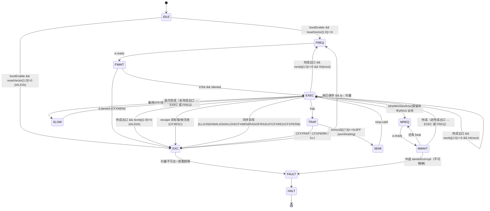

# M12 多周期状态机设计分析（推荐方案，待用户裁定）

> **任务**：`m12-chipyard-006`（只分析、不实现；不改 RTL、不建构建）
> **用户裁定（原话，2026-11-09）**：「ldm/stm，要做。多周期的状态机设计，应该提前进行；应该通过分析各条指令的实际运行情况，给出一个推荐方案，我来裁定；内部运算的逻辑，可以1到2个周期完成，ld/st类的，都需要存储接口的交互，这部分原本就应该多周期」
> **补充澄清（同日）**：「1–2 周期」是**举例**，3、5 周期也都可以——**周期数怎么合适怎么来**，不要被「单周期核」的名字绑住。
> **同日新增裁定（Tiny 上 hmon）**：Tiny 实现 `cfx_power`（cfx63）+ `cfx3 hmon`；hmon SRAM 复用 `0x0fff_0000_0000`（64 KiB）；**无 PTW/页表**；同步异常**不经 `trap` 指令**、直接进 hmon 向量；semihosting 的 `trap` 三平台统一写 `trap cfx_hmon`（实现只看 `immu18`、不判 `cfxha`）；`trap` 判定 = `immu18 ∈ 0x3FF00–0x3FFFF` ⇒ semihosting，`cfxha=3` + 其它 `immu18` ⇒ hmon。
> **证据基础**：`spec/SimRISC-00…12`、`spec/Machine-v5 §1.1/§1.2/§2/§3/§5/§7.1`、`spec/DADAO-12 §2.1/§2.2.6/§3/§4.12/§5`、`spec/DADAO-13 §1`（cg3）、`contracts/{opcodes,legality_rules}.yaml`、`.tao/contracts/contract-isa.md`、005 已落地的 `WumingCore/Decoder/RegFile/ALU/Tile`（运行期源码树）；参考实现 `wuming_1stage` 仅作结构溯源（**非执行依赖**）。

---

## 0. 结论摘要

1. **推荐方案 = 「1 拍快路径 + 共享慢路径序列器」的单 FSM，共 12 态**：`IDLE/FREQ/FWAIT/EXEC/TRAP/SEMI/EXC/MREQ/MWAIT/SLOW/FAULT/HALT`。不引入流水站、不做每类一张状态机；**异常/陷入走 `TRAP`→{`SEMI`,`EXC`} 两条去向**，`EXC` 统一做「保存 hmon 帧 + 跳向量」。
2. **纯寄存器运算推荐 1 拍**（不是硬约束）：Verilator 下组合深度几乎不计入仿真时长，而 1 拍直接决定 T0/T1（embench + inst 全量）的墙钟；`WumingCore` 与参考 1-stage 核同构。若为 FPGA 时序收敛，退化为 2 拍只是「RF 输出打拍」，**不改状态机**（R1）。
3. **`ld`/`st` 天然多周期**：单元素 **4–7 拍** = `EXEC` 1（地址/对齐/窗口检查）+ `MREQ` 1–3（等 `a.ready`，可能被背压）+ `MWAIT` 2–3（`d` 往返）；写回在响应拍完成。
4. **`ldm`/`stm` 推荐「8 字节 beat 分组 + mask Put」**（1 深度起步，2 深度 outstanding 可选加速）：不是逐元素一次事务，也不是 TL burst；周期 ≈ `beats × 3–4`。
5. **存储接口没有「重试」语义**：只有 `a.valid` 保持到 `a.ready`、`d.ready` 背压；`denied`/`corrupt` 按 `CFXMEM` 处理（005 现在是 `assert`，必须改；**取指预取的 `denied` 除外**，§5.5 第 7 条）。
6. **Tiny 的三段地址窗口**：BootROM `0xffff_ffff_0000`(64 KiB) / SRAM `0xffff_ff00_0000`(8 MiB) / **hmon SRAM `0x0fff_0000_0000`(64 KiB)**；窗口检查在 `EXEC` 内 1 拍完成（`CFXMEM` 精确、不需要碰总线）。
7. **异常不再停机**：同步异常（ILLI/UNDI/MALIGN/IALIGN/`CFXMEM`/RASOF/RASUF/CFXREG/CFXPERM）→ 保存 hmon 帧 → 跳 hmon 向量，由 hmon handler 处理（典型做法是算退出码后走 semihosting `SYS_EXIT`）。`FAULT/HALT` 只保留为**实现缺陷/向量不可达/嵌套超限**的兜底。
8. **对 005 的结论：较大改动**（不再是「局部重写」）——重写 FSM 与执行分流（~80%）、新增 cfx 寄存器单元、SoC 地址图新增 hmon 段与装载链路；**tile 外壳结构不变**（§5.8）。
9. **需用户裁定 16 项**（§8，R1–R16）。

**每类周期（推荐值一览）**

| 类 | 内容 | 执行拍 | 说明 |
| --- | --- | --- | --- |
| A | 纯寄存器运算（算术/逻辑/移位/比较/位操作/位扫描/条件赋值/立即数赋值） | **1** | 组合 ALU + RF 读→写单拍 |
| A2 | 分支 / `jump` | **1** | 目标未预取时额外 2–3 拍取指 |
| A3 | `call` / `ret`（RegRAS 命中） | **1** | RAS 为寄存器阵列，C1–C3a/D1–D3 组合完成 |
| A4 | `call` / `ret`（需 MemRAS 访存） | **4–10** | 读条目（+可能写回）+ 精确判定 |
| B1 | `mul.uo/so`、`clmul.o`（128 位结果） | **1**（可选 2） | R2 |
| B2 | `mul.ut/uw/ub` | **1** | |
| B3 | `div`/`rem`（`.o/.t/.w/.b`） | **33 / 17 / 9 / 5** | radix-4，R3 |
| B4 | FP 非迭代（加/减/乘/FMA/比较/分类/转换/取整/最小最大/缩放/符号） | **1–2** | recFN 组合 + 单次舍入 |
| B5 | FP `div`/`root`/`rem` | **≈30（单）/ ≈56（双）**；`rem` ≈ 2× | 估计，实现期实测（R4） |
| C | `ld`/`st` 单元素（`.b/.w/.t/.o`，四银行） | **4–7（典型）** | 见 §3.3 分解；上界由总线背压决定 |
| D | `ldm`/`stm`（N 元素、宽 W） | `beats × 3–4`，`beats=⌊(base%8+N·W+7)/8⌋` | 2 深度时 ≈ `beats+4` |
| D′ | 块复制 `rd2rd/rb2rb/rb2rd/rd2rb/rf2rd/rd2rf/ft2ft/fo2fo` | **⌈N/2⌉** | `ra2rd`/`rd2ra` 建议 **N** |
| E | `lr` / `sc` | **5–7** / **5–7**（无保留标记失败 **2**） | |
| F | semihosting `trap` | **1 + 宿主变长** | `SYS_EXIT` 不返回 |
| G1 | 同步异常进入（→ hmon 向量） | **4–5** | `EXEC`1 + `EXC`1 + 取指 2–3 |
| G2 | `trap cfx3`（CFXTRAP → hmon） | **4–5** | `TRAP`1 + `EXC`1 + 取指 |
| G3 | `escape`（回帧） | **3–4** | `EXEC`1 + 取指 |
| G4 | `cfx2rd`/`cfx2rc`（cfx3/cfx63） | **1** | 寄存器直读/直写 |
| G5 | `fence` / `swym` | **1** | 无写缓冲 ⇒ 顺序天然满足 |

---

## 1. 口径与依据

### 1.1 周期口径

- **「拍」= 核时钟周期**。
- **「执行拍」**：从进入 `EXEC`（该指令译码/操作数就绪）到该指令架构效果全部完成（写回、`ip` 更新、异常帧保存、进向量）之间的拍数，**不含取指**。
- **「稳态总拍」**：执行拍 + 取指摊派（命中 0；未命中一次 8 字节 beat 摊派 2–3 拍，§5.5）。
- **CPI**：稳态总拍/指令。**验收不比时序**（`m12-chipyard-005` 验收口径即「不比时序」），周期数只影响：① 仿真墙钟；② 面积/时序；③ 「时延类」指令（`swym`）与异常进入的可观测拍数。

### 1.2 边界

- 本报告**不实现**：不写 RTL、不建构建、不改 `spec/`、不改 `contracts/`、不动 `milestones*.md`。
- **用户裁定与现行 spec 有偏差**（Tiny 目前写的是「不实现任何 cfx（含 `cfx_power`）、无 hmon/向量」）：本报告按裁定做设计，并把必须修订的 spec 条目逐条列在 **§9**。实现前需 spec 修订落盘（属 spec 任务）。

---

## 2. 基线：005 现状（先纠正一处描述）

任务书说 005 是「取指/执行两态」。**实际源码是 9 态 FSM**（运行期源码树 `WumingCore.scala`）：

```
sIdle → sFetch → sFetchReq → sFetchWait → sExec → {sMemReq → sMemWait | sSemi | sHalt}
```

现状成本（8 字节取指 beat 命中时）：纯 ALU = `sFetch`+`sExec` = **2 拍/指令**，每 2 条指令跨一次 beat 再 +2 拍 ⇒ **纯 ALU 段 CPI ≈3.0**；访存 = 3–5 拍；semihosting = 变长；**任何故障直接 `sHalt` 停机**。

现状 **6 处**必须在 007 之前改掉：

1. `assert(!(tl.d.valid && tl.d.bits.denied))`：**`denied` 是正常的「未映射」响应，必须变成 `CFXMEM`**（`spec/Machine-v5 §1.2`）；assert 会把合法测试程序打成仿真中断。
2. 数据通路只有**整 8 字节 Put**（005 只实现 `ld.o`/`st.o`）；若 007 照该形状扩到 `st.b/.w/.t`，一次写会破坏相邻字节 ⇒ 必须「整 beat Put + byte mask」。
3. 取指缓冲只有 1 个 beat 且无预取 ⇒ 取指开销约占 1/3（§5.5 预取）。
4. **没有 IALIGN 检查**：`spec/SimRISC-00 §3` / `DADAO-12 §5.0` 要求取指前检测 `IP[1:0]≠00`；005 直接按 `ip[47:3]` 取 beat，未对齐目标会被静默取指。
5. **异常一律停机**：无 hmon 帧保存/向量跳转，故障只能 `sHalt`；按新裁定必须改为进 hmon 向量（§3.8）。
6. 只有 `rd`/`rb` 两银行、无 `ra`/`rf`、无 RAS、无 `lr`/`sc` 保留标记、无 FP、无 cfx 寄存器（后续任务补全）。

**结论：结构可扩展**（单 Module、TL 直连、状态-动作式写法），但按 hmon 裁定需**较大改动**，不是「局部重写」（§5.8）。

---

## 3. 逐类分析（按执行特性，不按指令册）

分类依据 4 个正交属性：**是否需要存储接口** / **是否需要内部迭代** / **是否需要等外部（宿主）/改特权状态** / **是否改变控制流**。

### 3.1 类 A：纯寄存器运算 —— 推荐 1 拍

覆盖（全册）：算逻移比较（`SimRISC-04/05/08/09/10`）、`rev.*`/`rol.*`/`ext.*`/`cmp.*`、`ctlz`/`cttz`/`ctpop`（`SimRISC-12`）、`cs.*`（`SimRISC-02`）、`set.zw`/`set.ow`/`or.w`/`andn.w`/`set.w`（`SimRISC-03`）、`add.si`/`aip.si`（`SimRISC-05`）。

**1 拍的依据**：

- 数据通路 = 「RF 读（组合）→ ALU（组合）→ RF 写（边沿）」，与参考实现 `wuming_1stage` 同构，是**单周期核的标准结构**；64 位 ALU + 64×64 寄存器堆在 FPGA 上也是常规单周期路径。
- **Verilator 下组合深度几乎不花时间**（一个 eval 内算完组合锥；耗时 ≈ 拍数 × 每拍活动门数）。1 拍直接省的是所有后续任务的仿真墙钟（T0/T1 与 M13 长跑都以 CPI 为乘数）。
- 反面（2 拍）只在时序收敛/ASIC 场景有收益，代价是快路径 CPI×2。

**例外**：`mul`/`clmul` 归 B1、`div`/`rem` 归 B3、块复制归 D′、`trap`/`escape`/`cfx2rd`/`cfx2rc` 归 G。

### 3.2 类 B：内部多周期运算

**B1 乘法（`mul.uo`/`mul.so`/`clmul.o`，128 位双目的）**：推荐 **1 拍**（组合 64×64 → 128；`clmul` 是 64 个 AND + XOR 树）。备选 2 拍（两级 32×32 拆分 + 结果寄存）。`SimRISC-04 §1.4` 要求「先读全部源再写结果」，1 拍天然满足。

**B2 窄乘法**：1 拍。

**B3 除法/取余**：**必须迭代**。推荐 **radix-4（每拍 2 位）**：

| 宽度 | radix-4 拍数 | radix-2 拍数 | 依据 |
| --- | --- | --- | --- |
| `.o` (64) | 33 | 65 | ⌈64/2⌉ + 1（符号修正/收尾） |
| `.t` (32) | 17 | 33 | ⌈32/2⌉ + 1 |
| `.w` (16) | 9 | 17 | ⌈16/2⌉ + 1 |
| `.b` (8) | 5 | 9 | ⌈8/2⌉ + 1 |

理由：`div` 动态占比 <1%，**用拍数换面积**合算；radix-4 商选择只有 3 个候选，面积远小于 radix-16（R3）。

**B4 FP 非迭代**（`SimRISC-07`：`f*add/sub/mul/fma/qcmp/scmp/cls/min/max/rnd/sclb/sgnn/sgnj`、格式转换、整数↔浮点转换）：**1–2 拍**（recFN 编解码 + 六档舍入一次；FMA 单次舍入可选 2 拍）。不改变 FSM，只延长 `EXEC` 组合路径或复用 `SLOW` 的 1 拍寄存级。

**B5 FP 迭代**（`f*div`、`f*root`（仅 n=2）、`f*rem`）：`div`/`root` 按 hardfloat `DivSqrtRecFN_small` 逐位迭代估算 **≈30 拍（单精）/ ≈56 拍（双精）**（**估计，实现期实测**）；`rem` = `x − n·y` 两趟 ≈ `2×div + 4`。与整数除法共用 `SLOW` 态（`slowKind` + 计数器 / `fpu.busy/done`），不新增状态。

### 3.3 类 C：单次访存 `ld`/`st` —— 天然多周期

覆盖 `SimRISC-01`：`ld.sb`/`ld.ub`/`ld.sw`/`ld.uw`/`ld.st`/`ld.ut`/`ld.o`/`ld.t`；`st.b`/`st.w`/`st.t`/`st.o`。银行范围：`rd` 全宽度、`rb`/`ra` 仅 `.o`、`rf` 仅 `.o`/`.t`（`SimRISC-01 §1–§4`）。

**周期分解（推荐）**：`EXEC` 1 拍（地址计算 + 对齐 + 窗口检查 + 分流）→ `MREQ` **1–3 拍**（`a.valid` 保持到 `a.ready`；`ready` 可能被 xbar/其它主机背压）→ `MWAIT` **2–3 拍**（`d` 往返）→ 写回在 `d.fire` 拍完成 ⇒ **4–7 拍（典型）**；`a.ready`/`d` 被长时间背压时不设硬上界。

**对齐/越界检查放在哪个状态 —— 结论：`EXEC` 内、任何总线请求之前。**

- 对齐（MALIGN）：`addr % width ≠ 0`；`.b` 无要求；`ldm`/`stm` 用起始地址 `% W`。
- 越界（`CFXMEM`）：Tiny **三段窗口**（§1.1 + hmon 裁定）——BootROM `0xffff_ffff_0000`+64 KiB、SRAM `0xffff_ff00_0000`+8 MiB、hmon SRAM `0x0fff_0000_0000`+64 KiB；核内**区间比较**即可判定，不需要碰总线；`ptw_enable=0` 时「`addr[47:42]==0` ⇒ `CFXMEM`」由「不落在任何窗口」自动覆盖。
- 为什么不在 `MWAIT` 靠 `denied` 判：① 那时已发过请求，`ldm`/`stm` 中途发现就**无法精确**；② 005 的 `assert` 直接终止仿真；③ 窗口预检少一次总线往返。
- `denied`/`corrupt` 保留为**兜底**：一律 `CFXMEM`（不 assert），正常路径不应出现。

**子拍访问**：总线**只用 8 字节粒度**——读用 beat 对齐的整拍 `Get`，核内按 `addr[2:0]` 提取并做符号/零扩展；写用 beat 对齐的整拍 `Put` + **byte mask**。大端：beat 内按「字节 0 = 最低地址」重组（005 的 `addressOrder`/`laneOrder` 已有，保留）。

### 3.4 类 D：多寄存器 `ldm`/`stm` —— 三种方式对比

覆盖 `SimRISC-01`：`ldm.o`/`ldm.sb`/`ldm.ub`/`ldm.sw`/`ldm.uw`/`ldm.st`/`ldm.ut`/`ldm.t`；`stm.b`/`stm.w`/`stm.t`/`stm.o`。银行范围同 §3.3。语义要点：地址 = `rbHB + rdHC`；`immu6` = 元素个数（1–63）；元素 i 在 `addr + i·W`；**按序号递增逐对处理**；地址计算用**原始的** `rdHC`/`rbHB`；`immu6=0`/越界/目的 `rd0`/`rb0` ⇒ ILLI（`legality_rules.yaml` 的 `mreg_zero`/`mreg_range_overflow`/`dst_rd0`/`dst_rb0`）。

| 方式 | 周期（N=8, `.o`） | 总线事务 | 优点 | 缺点 |
| --- | --- | --- | --- | --- |
| ① 逐元素一次事务 | 8×4 = 32 | 8 次 8 字节 Get/Put | 实现最简单 | `.b/.w/.t` 严重浪费带宽（8 个 `.b` 只要 1 beat 却发 8 次） |
| ② **8 字节 beat 分组（推荐）** | 8 beats × 3–4 = 24–32；2 深度 ≈12–14 | `beats` 次（`beats=⌊(base%8+N·W+7)/8⌋`） | 一次 beat 内组合提取/打包多个窄元素 | beat 内多路选择 + mask 打包 |
| ③ TL burst | 首 beat + 后续 ≈1 拍/beat | 1 个 burst | 理论最快 | SRAM 是否支持需确认；异常粒度变粗；与「逐对处理」语义映射复杂 |

**推荐 ②**。关键论据：**任何宽度的元素都不跨 8 字节 beat 边界**——`.b` 单字节不可能跨界；`.w`（2 对齐）偏移 ∈{0,2,4,6}；`.t`（4 对齐）∈{0,4}；`.o`（8 对齐）=0。所以「按 beat 分组 + 组内按序号提取/打包」与 spec 的「递增逐对处理」等价，且 `ldm.b` 63 个元素只需 8–9 个 beat（vs 63 次事务）。

`stm` 组内打包必须用 **mask Put**：一个 beat 里可能只有部分字节属于本次写入 ⇒ `mask = 覆盖 [base%8 + i·W, +W) 的字节`，其余字节不写。

**异常处理（推荐：整段预检 + 中途故障即停机）**：

- 静态（译码）：`immu6=0`、`start+immu6>64`、目的 `rd0`/`rb0` ⇒ ILLI（进 hmon 向量，`cause_ip` = 该指令）。
- 动态对齐：`addr % W ≠ 0` ⇒ MALIGN，**发第一个 beat 之前**判定（`EXEC`）⇒ 精确。
- 动态越界：`[addr, addr+N·W)` **整段**窗口检查 ⇒ `CFXMEM`，**发第一个 beat 之前**判定 ⇒ 精确（选窗口预检而非「逐元素碰运气」的核心理由：中途失败会留下半完成状态，spec 未定义其精确语义）。
- 兜底：`MWAIT` 收到 `denied`/`corrupt`（预检通过但总线拒绝，属实现/硬件缺陷）⇒ **`FAULT`→`HALT`**（诊断标明第几 beat），**不假装精确**（不重试、不回滚、不进 hmon）。
- 中断：Tiny 无中断；一般规则（不得在 `ldm`/`stm` 中途响应中断）写进 008 的设计约束。

**周期估算**：`beats = ⌊(base%8 + N·W + 7)/8⌋`，每 beat 3–4 拍；`N=8 .o` ⇒ 8 beats ≈ 24–32 拍；2 深度 outstanding ≈12–14 拍（R6）。

### 3.5 类 D′：寄存器块复制

`rd2rd`/`rb2rb`/`rb2rd`/`rd2rb`/`rf2rd`/`rd2rf`/`ra2rd`/`rd2ra`（`SimRISC-02`）与 `ft2ft`/`fo2fo`（`SimRISC-07 §1.3`，同为 1–63 个连续寄存器）：`immu6` 个连续寄存器。合法性要求源/目的范围**不得重叠**（`mreg_range_overlap`）。

- 一般银行间复制：**⌈N/2⌉ 拍**（每拍 2 个寄存器：2 读 2 写；不重叠 ⇒ 无 RAW 冒险）。
- `ra2rd`/`rd2ra`：涉及 RAS（`ra0` 的 `RACNT`/`MRPTR`、环形缓冲基准索引换算）⇒ **N 拍**（每拍 1 条，换算简单；R9）。
- 都走 `SLOW`（`slowKind = blockCopy`，计数器递减）。

### 3.6 类 E：原子 `lr`/`sc`（`SimRISC-12`）

- `lr.<w>.<nn|an|ar>`：读内存（同 `ld` 4–7 拍）+ **同拍**置保留标记（地址 + 宽度）⇒ **5–7 拍**。
- `sc.<w>.<nn|nr|ar>`：`EXEC` 内 1 拍比较保留标记（地址 + 宽度精确匹配）：命中 ⇒ 普通 `st` 通路（4–7 拍）+ 同拍写 `rdHB = 0`；未命中 ⇒ **不发总线**，`rdHB = 1`，**2 拍**结束（`EXEC` + 下一条）。无论成败清除本 hart 保留标记。
- `.an/.ar/.nn/.nr` 在**顺序单发、无写缓冲**的核上等价：没有可重排窗口，acquire/release 语义天然满足（**必须显式写出这个等价性理由**，否则会被当成静默忽略）。
- 保留标记粒度 = **精确地址 + 访问宽度** ⇒ 一个寄存器 `{valid, addr[47:0], width[1:0]}`。

### 3.7 类 F：semihosting `trap`（`SimRISC-11` + `Machine-v5 §5`）

- 判定：`immu18[17:8] == 0x3FF` ⇒ semihosting（**与 `cfxha` 无关**；三平台统一写 `trap cfx_hmon`，实现只看 `immu18`）。
- 核只做「**抬请求 + 等标量应答**」，宿主行为全在 harness（004 边界）；**参数块读取由 responder 用自己的 TL 口完成**，不占核的数据通路 ⇒ 核侧 = `TRAP` 1 拍 + `SEMI` **变长**（无上界）。
- `SYS_EXIT`/`SYS_EXIT_EXTENDED`：responder 直接 `std::exit`（004 实现），**永不回 `resp.valid`** ⇒ `SEMI` 必须容忍「永远等不到」，**不得设超时/故障**。
- 电平原语：`req.valid` 在 `SEMI` 期间保持高，`resp.valid` 到达那拍离开 `SEMI` 并撤销 `req`（与 004 的 `WumingSemi.v` 一致）。

### 3.8 类 G：陷入与同步异常（hmon/power）

**Tiny 的 cfx 范围（本次裁定）**：`cfx63`（`power`）+ `cfx3`（`hmon`）；其余 cfx **未实现**。

**G-a 同步异常进入（无 `trap` 指令）**：ILLI/UNDI/MALIGN/IALIGN/`CFXMEM`/RASOF/RASUF/CFXREG/CFXPERM → 目标 = **当前运行模式 monitor**；Tiny 恒 `hypv`、monitor = `hmon`（cfx3）。硬件序列（`DADAO-12 §5.2` 步骤 4–7）：

1. 递增 `cfx_hmon` 的 `excp_sync_num`（trap 走 `trap_num`）；
2. 保存 `excp_prev_run_mode`（=3）、`excp_cause_ip`（同步 = 触发指令地址；**IALIGN = 非法地址**，见 §5.7）、`excp_cause_id`（one-hot）、`excp_cause_info`（`CFXMEM` = 访存地址、`CFXREG` = 指令编码）；
3. `inner_run_mode` ← `cfx_hmon_hypv_switch_run_mode`（=3，Tiny 不变）、`inner_cfx_code` ← 3；
4. `ip` ← `cfx_hmon_hypv_excp_vector`。

**周期**：`EXEC` 1（检测）+ `EXC` 1（写帧/跳向量）+ 取指 2–3 ⇒ **4–5 拍**到 handler 第一条指令。

**G-b `trap cfxHA, immu18`（同一 `TRAP` 状态两种去向）**：

| 条件 | 去向 | 周期 |
| --- | --- | --- |
| `immu18[17:8]==0x3FF`（0x3FF00–0x3FFFF） | **semihosting**：短路，不进向量（`TRAP`→`SEMI`） | 1 + 变长 |
| `cfxha ∈ {3,63}` 且目标 cfx 的 `hypv_cfxtrap` 掩码允许 | **CFXTRAP** → 目标 cfx 向量（`TRAP`→`EXC`） | 4–5 |
| `cfxha ∈ {3,63}` 但 `cfxtrap` 掩码拒绝 | **CFXPERM** → 当前 monitor（hmon） | 4–5 |
| `cfxha` 为保留（6–14、16–31、35–61） | **ILLI** → hmon | 4–5 |
| `cfxha` 为其它未实现 cfx（0/1/2/4/5、15、32–34、36–62 等） | **ILLI** → hmon（Tiny 口径；需 spec 明确，§9） | 4–5 |

> **CFXTRAP 的 `cause_info` = `trap` 的指令编码**（`DADAO-12` 异常表），因此 hmon handler 可以从 `excp_cause_info` 取回 `immu18` 做服务分派——这是「一般 trap 走 hmon」的实现要点（semihosting 不走这条路，核内直接短路）。
>
> **trap 进入（CFXTRAP）另需**：保存当前 monitor 的 `global_cfx_intr_mask`（cg8 rc1）到目标 cfx 的帧，并把该 mask 置全 1，供 `escape` 恢复（`DADAO-12 §5.2` 步骤 5）。
>
> **semihosting 判定优先于 `cfxha` 合法性**：`Machine-v5 §5` 明写「与 `cfxha` 无关」，因此即使 `cfxha` 是保留值，`immu18[17:8]==0x3FF` 仍走 semihosting 短路（这是三平台统一写 `trap cfx_hmon` 的实现前提：核只看 `immu18`）。
>
> 掩码默认值（`DADAO-12 §3.1/§3`、`DADAO-13 §1`）：`hypv_cfxtrap` = `0xFFFF_FFFF_FFFF_FFF7`（hmon 自身为 `0x7FFF_FFFF_FFFF_FFF7`）。bit63=0 ⇒ `power`(63) 可 trap 到 hmon；bit3=0 ⇒ hmon 自身位忽略。这两条正是 Tiny 启动移交（G-e）能工作的前提。

**G-c `escape cfxHA, [excp_cause_ip, 0|4]`**：要求 `cfxha` = 当前 cfx **且** 帧有效位 `frameValid[cfx]`=1（`EXC` 置位、`escape` 成功清除）；否则（目标错误/帧错误）⇒ **CFXESC** → 当前 cfx（hmon）。正常路径：`nextIp` = `excp_cause_ip + (imms18<<2)`，恢复 `excp_prev_run_mode`/`curCfx` 与 trap 时保存的 `global_cfx_intr_mask`，`escape_num` +1，`excDepth`−1 —— 然后走**完成出口**（§5.3）。**1 拍 + 取指（3–4 拍）**；编码层 `imms18[17:1]` 为 SBZ、非 0 ⇒ ILLI（先于任何状态切换）。

**G-d `cfx2rd`/`cfx2rc`**：cfx3/cfx63 的 `cfxha`/`cg`/`rc` 寄存器访问（cg3/cg4/cg5/cg6/cg8）；**1 拍**。Tiny **无异步中断源**，`*_cfx_intr_mask`/`excp_pending` 只作可读写寄存器（不产生行为），`trap`/`escape` 的保存/恢复仍按规范执行以保持与 Vast 一致。`cfxha` 为**保留**（`6–14`、`16–31`、`35–61`）⇒ **ILLI** → hmon（4–5 拍；`DADAO-12 §5.1`/`§5.2(一)` 明列 `cfx2rd`/`cfx2rc`，QEMU `helper_cfx2rd` 在 `cfx_enabled` 后亦先判 reserved ⇒ ILLI）；**已分配未实现**（如 `cfx5` cache）⇒ **CFXREG** → hmon；`cg`/`rc` 保留位 ⇒ CFXREG。Tiny 恒 hypv，cg3 的 hypv-only 约束天然满足。

**G-e `power`→`hmon` 启动移交（状态与时机）**：

1. 复位：`ip` ← `cfx_power_hypv_excp_vector` = `0xffff_ffff_0000`（BootROM），`curCfx` = 63（power）、`runMode` = 3（hypv）；
2. power 段 stub 完成自身初始化（hmon 镜像可由宿主 loader 直装 hmon SRAM，R13），**先**用 `cfx2rc cfx_hmon_hypv_excp_vector, <rd 含 0x0fff_0000_0000>` 显式写 hmon 向量（**前置**：`DADAO-13 §1` 的默认值 `0x3ff_ffff_0000` 与 hmon SRAM 不重合，若 §9 第 7 条未修且未写该寄存器，`EXC` 首跳即 `CFXMEM` 递归；默认 `cfxreg` mask 位 63=0 ⇒ power 写 hmon 寄存器被允许），再执行 `trap cfx3, <immu18 < 0x3FF00>`；
3. `TRAP` 判定 = CFXTRAP（掩码允许，bit63=0）→ `EXC`：保存 **hmon** 帧（`cause_id=CFXTRAP`、`cause_ip` = 该 trap 的 IP）、`curCfx` ← 3、`ip` ← hmon 向量（由第 2 步写入的 `0x0fff_0000_0000`）；
4. hmon 入口：复核自己的向量（`cfx2rc cfx_hmon_hypv_excp_vector, <rd 含 0x0fff_0000_0000>`，幂等），初始化栈/暂存，然后 `escape cfx3, [excp_cause_ip, 4]` 返回 stub 的下一条指令；
5. stub 跳应用入口（`0xffff_ff01_0100`）；此后测试本体同样在 hypv 运行，**monitor 仍是 hmon** ⇒ 任何同步异常都进同一个向量。

> 若 hmon 直接接管而不返回（例如 hmon 自己跳测试入口），第 4 步可省 `escape`——两种都合法，**推荐返回式**（保持「power 只做装载/移交」的职责单一，且顺带验证 `escape` 路径）。

**G-f 何时仍然 `FAULT`→`HALT`**（不是异常语义，是实现兜底）：

- 向量/目标地址**不落在任何窗口**（`CFXMEM` 无法进向量，否则会无限递归）；
- `ldm`/`stm` 中途 `denied`/`corrupt`（无法精确）；
- 异常嵌套深度超限（R15；Tiny 单 monitor，嵌套会覆盖帧）；
- hmon 自身的取指/访存持续故障（handler 不可用）。

### 3.9 异常优先级与 `ip` 语义（先给出结论，细节见 §5.7）

| 来源 | 类别 | 检测点 | `cause_ip` | `ip`（EXEC 内是否更新） |
| --- | --- | --- | --- | --- |
| `ip[1:0] ≠ 0` | IALIGN | 目标计算后、发取指前（`EXEC`） | **非法地址（nextIp）** | **写回照常 + `ip←nextIp`**（取指前检查；`DADAO-12 §5.0`「IP 停留在非法地址」） |
| 保留编码/非法组合/未实现编码 | UNDI / ILLI | 译码（`EXEC`） | 触发指令 `ip` | 不更新 |
| `addr % W ≠ 0` | MALIGN | 地址计算后、发请求前（`EXEC`） | 触发指令 `ip` | 不更新 |
| 窗口外 / `denied` / `corrupt` | CFXMEM | `EXEC`（预检）或 `MWAIT`（兜底） | 触发指令 `ip` | 不更新 |
| RAS 溢出/下溢 | RASOF / RASUF | `EXEC`（RegRAS）或 MemRAS 读回后（`MWAIT`） | 触发指令 `ip` | 不更新 |
| 非法 cfx 寄存器访问 | CFXREG | 译码/执行（`EXEC`） | 触发指令 `ip` | 不更新 |
| 掩码拒绝 | CFXPERM | `TRAP`/`EXEC` | `trap` 的 `ip` | 不更新 |

`EXC` 统一把 `ip` ← 向量；**除 IALIGN 外**的故障路径不写目的寄存器/内存/RA（精确异常）。

---

## 4. 备选方案

### 方案 A：统一多周期状态机（每指令固定 ≥4 拍，逐相位推进）

每个相位一个状态（`FETCH→DECODE→EXEC→MEM→WB`），任何指令都走满。

- 优点：路径等长、波形最好读、组合路径最短。
- 缺点：CPI 4–6，T0/T1 仿真时间 ×4–6；**Verilator 下组合深度本来不花时间，只买到「好看」**；`ldm/stm`、`div`、FP 迭代仍需额外计数循环，规整性并不彻底。
- 适用：以 ASIC 时序为首要目标、仿真预算充裕时。

### 方案 B：1 拍快路径 + 共享慢路径序列器（**推荐**）

`EXEC` 一拍完成「译码 + 合法性 + RF 读 + ALU + 写回 + `ip` 更新」；慢指令在 `EXEC` 内分流到 `TRAP`/`EXC`（陷入/异常）、`MREQ/MWAIT`（访存）、`SLOW`（乘/除/FP/块复制）、`SEMI`（宿主）。

- 优点：常用路径 CPI≈1（预取后），**最省仿真时间**；与 005 形状同构（扩展而非重写）；异常精度由「发请求前检查 + 精确帧保存」构造性成立。
- 缺点：`EXEC` 是全核最长组合路径（RF 读→译码→ALU→RF 写）；hmon 让 FSM 多出 2 态与一整套 cfx 寄存器（R12 影响改造量评估）。

### 方案 C：两站流水（F | E+M | W）

- 优点：CPI → 1.0–1.3。
- 缺点：RAW 冒险/前递（128 位双目的、`rb0=IP`、多银行）、异常重定向（`ip` 与在飞取指）、`call/ret` 与 RAS 顺序、`ldm/stm` 与后续取指的交互；对「每类周期数」无额外信息量。
- 结论：**M12 不做**（R11）。

| 维度 | A 统一多周期 | **B 快慢路径** | C 两站流水 |
| --- | --- | --- | --- |
| 快路径 CPI | 4–6 | **≈1.0** | ≈1.0–1.3 |
| Verilator 墙钟 | 最慢 | **最快** | 快（验证成本高） |
| 状态数 | ~9（+3 计数） | **12** | 14+ |
| 异常精确性 | 容易 | 容易（预检 + 帧） | 较难（在飞指令） |
| 与 005 的衔接 | 重写 | **扩展 + 较大改动** | 重写 |
| 实现风险 | 低 | **中** | 高 |

---

## 5. 推荐方案详述

### 5.1 状态集与职责（12 态）

| 状态 | 职责 | 备注 |
| --- | --- | --- |
| `IDLE` | 等 `bootEnable`；`ip←resetVector`（power 向量）；检查 `resetVector[1:0]` | 005 已有 |
| `FREQ` | 发需求取指 `Get`（beat 对齐，`source=0`），`a.valid` 保持到 `a.ready` | 合并 005 的 `sFetchReq` |
| `FWAIT` | 等 `d`，收 beat 入缓冲；`denied` ⇒ `CFXMEM`（进 `EXC`） | 合并 005 的 `sFetchWait` |
| `EXEC` | 译码 + 合法性 + RF 读 + ALU + 写回 + `ip` 更新 + **命中检查** + 地址/对齐/窗口检查 + 分流 + `escape`/`cfx2*` | **吸收 005 的 `sFetch`**（命中即执行） |
| `TRAP` | `trap` 两去向分流：`immu18[17:8]==0x3FF` ⇒ 抬 `req` 去 `SEMI`；否则判定 CFXTRAP/CFXPERM/ILLI | 新增 |
| `SEMI` | 等宿主 `resp.valid`（变长；`SYS_EXIT` 不返回） | 005 已有 |
| `EXC` | 保存目标 cfx 的异常帧（`prev_run_mode`/`prev_cfx`/`cause_ip`/`cause_id`/`cause_info`）+ 计数 + `excDepth` + `curCfx←目标` + `ip←向量` | 新增 |
| `MREQ` | 发数据 `Get`/`Put(mask)`（`source=1`），`a.valid` 保持到 `a.ready` | |
| `MWAIT` | 等 `d`；`denied/corrupt` ⇒ 兜底 `FAULT`；`d.fire` 拍完成写回/元素提取/mask 打包/写 `rdHB`/设保留标记 | 吸收 005 的 `sMemWait` |
| `SLOW` | 内部迭代：乘第 2 拍、除法计数、FP `busy`、块复制计数、`swym` 计数 | 新增 |
| `FAULT` | 兜底故障登记（§3.8 G-f），1 拍，打印诊断 | 005 的 `sHalt` 拆分 |
| `HALT` | `halted=1` | 005 已有 |

与 005 的映射：`sFetch` **删除**（并入 `EXEC` 命中检查）；`sFetchReq`→`FREQ`；`sFetchWait`→`FWAIT`；`sExec`→`EXEC`；`sMemReq`→`MREQ`；`sMemWait`→`MWAIT`；`sSemi`→`SEMI`（保留）；`sIdle` 保留；`sHalt`→`FAULT`+`HALT`（拆分）；**新增 `TRAP`、`EXC`、`SLOW`**。

### 5.2 状态图



> `EXEC → EXEC` 自环就是「1 拍/指令」：完成出口把 `ip` 更新为 `nextIp`，下一拍 `EXEC` 用新 `ip` 做命中检查与译码；未命中才走 `FREQ/FWAIT`。

### 5.3 状态转移表

**完成出口（finish，所有指令/所有「完成」路径共用同一处逻辑，避免条件重复）**

指令的**最后一拍**组合地依次做：

1. `ip ← nextIp`（`nextIp`：普通指令 = `ip+4`；控制流/`escape` = 目标地址）；
2. **IALIGN**：`nextIp[1:0] ≠ 0` ⇒ 记 `cause←IALIGN`、`causeIp←nextIp` → `EXC`（**不进 `FREQ`、不取指**）；
3. **命中**：`hit(next)` ⇒ `EXEC`；否则 → `FREQ`。

写回（RF/内存/RA）在与第 1 步**同一拍**完成——这就是「IALIGN 时触发指令照常写回」的来源（`DADAO-12 §5.0`「IP 停留在非法地址」）。**顺序固定为「IALIGN → 命中」**，所以「跳到未对齐目标且下一 beat 未命中」只可能走 `EXC`，不会误进 `FREQ`。

**`ip` 只有四处写入点；这四处的对齐检查共同保证「进入 `EXEC`/`FREQ` 时 `ip` 恒对齐」**：完成出口（先 `ip←nextIp`，再查 `nextIp[1:0]`，未对齐 ⇒ `EXC`、不取指）、`IDLE`（查 `resetVector`，未对齐 ⇒ `EXC`）、`EXC`（查向量，未对齐 ⇒ `FAULT`）、`SEMI`（`ip+4`，入口已对齐 ⇒ 结果恒对齐）。**「四处写入都保证 `[1:0]==0`」并不成立**——完成出口的 IALIGN 分支与 `IDLE` 的未对齐行是**刻意**把 `ip` 写成非法地址（`DADAO-12 §5.0`「IP 停留在非法地址」）；成立的**不变式**是「进 `EXEC`/`FREQ` 前恒对齐」。因此不需要单独加「进入 `EXEC` 查 `ip`」行（若某天新增第 5 处 `ip` 写入，必须同样先过对齐检查）。

> **`EXEC` 内按下列行序逐条判定，命中第一条即离开 `EXEC`**。口径：⓪ 是「不能开始」而非故障（`hit(cur)` 不成立时无法译码）；①②③ 是译码/执行期故障，顺序取 `DADAO-12 §2.2.6` 的 ILLI/UNDI → MALIGN → 存储，全部在**发请求之前**判定且**不写回**，故异常精确；IALIGN 属「取指前检查」，在完成出口判定——它不可能与 ①②③ 同时成立（非法/未定义编码不产生控制流副作用，`ip+4` 恒对齐），§2.2.6 的优先级顺序因此不受影响。

| 当前态 | 条件（按优先级） | 动作 | 次态 |
| --- | --- | --- | --- |
| `IDLE` | `bootEnable ∧ resetVector[1:0]==0` | `ip←resetVector`；`curCfx←63`；`runMode←3` | `FREQ` |
| `IDLE` | `bootEnable ∧ resetVector[1:0]≠0` | `ip←resetVector`（IP 停留在非法地址）、`causeIp←resetVector`、`cause←IALIGN` | `EXC` |
| `FREQ` | `a.ready` | 记录在飞事务类型 | `FWAIT` |
| `FWAIT` | `d.fire ∧ ¬denied` | 收 beat 入缓冲（地址/数据/valid） | `EXEC` |
| `FWAIT` | `d.denied ∨ corrupt` | 记 `cause←CFXMEM`、`causeIp←ip` | `EXC` |
| `EXEC` | ⓪ `¬hit(cur)`（当前 `ip` 所在 beat 不在缓冲） | 不执行、不写任何状态；发需求取指（`source=0`） | `FREQ` |
| `EXEC` | ① ILLI / UNDI / CFXREG | 不写回；记 `cause`、`causeIp←ip` | `EXC` |
| `EXEC` | ② MALIGN / 窗口外 | 不写回；记 `cause←MALIGN/CFXMEM`、`causeIp←ip` | `EXC` |
| `EXEC` | ③ RASOF / RASUF | 不写回（RA/内存保持原状）；记 `cause`、`causeIp←ip` | `EXC` |
| `EXEC` | ④ 快路径（含 `cfx2rd`/`cfx2rc` 的读/写） | 写回；`nextIp` = 该指令结果 | **完成出口** |
| `EXEC` | ⑤ 慢指令（乘/除/FP/块复制/`swym`） | 锁存操作数/计数/种类 | `SLOW` |
| `EXEC` | ⑥a `sc` ∧ 保留未命中（地址/宽度不匹配） | 写 `rdHB=1`、清本 hart 保留标记；**不发总线**；`nextIp`=`ip+4` | **完成出口** |
| `EXEC` | ⑥b 访存类（`ld/st/ldm/stm/lr`、`sc` **仅保留命中**、MemRAS） | 锁存 `memSeq`、基址、元素数、mask、写回目的、`nextIp` 初值（`call` = 目标、其余 = `ip+4`；`ret` 下溢的目标由 `MWAIT` 读回条目覆盖） | `MREQ` |
| `EXEC` | ⑦ `escape` ∧（`cfxha≠curCfx` ∨ 帧无效） | 记 `cause←CFXESC`（目标 = 当前 cfx）、`causeIp←ip` | `EXC` |
| `EXEC` | ⑧ `escape` ∧ `cfxha==curCfx` ∧ 帧有效 | 恢复 `prev_run_mode`/`curCfx`/`global_intr_mask`；`escape_num`+1；`excDepth`−1；清 `frameValid`；`nextIp`=`cause_ip+(imms18<<2)` | **完成出口** |
| `EXEC` | ⑨ `trap` | 锁存 `immu18`/`cfxha`（不写回） | `TRAP` |
| `TRAP` | `immu18[17:8]==0x3FF` | 抬 `req`（op/arg/ret/ip） | `SEMI` |
| `TRAP` | 非 semihosting ∧ 目标 cfx 的 `cfxtrap` 允许 | 锁存 `cause←CFXTRAP`、`causeIp←ip`、目标 cfx | `EXC` |
| `TRAP` | 非 semihosting ∧ 掩码拒绝 / 保留 cfx / 未实现 cfx | 锁存 `cause←CFXPERM/ILLI`、目标 = hmon | `EXC` |
| `SLOW` | 计数到 0 / `fpu.done` | 写回（含 `rf0` 标志按 sticky 合并）；`nextIp` = `ip+4` | **完成出口** |
| `SLOW` | `swym` 计数未到 | 递减 | `SLOW` |
| `MREQ` | `a.ready` | 记在飞事务类型 | `MWAIT` |
| `MWAIT` | `d.fire ∧ 还有 beat` | 写部分结果（load 子拍提取 / stm mask 打包）；推进 beat 指针 | `MREQ` |
| `MWAIT` | `d.fire ∧ 最后一 beat` | 写回 / 写 `rdHB` / 设保留标记 / 弹 MemRAS；`nextIp` = 事务目标（`call` = `EXEC` 锁存目标；`ret` 下溢 = 本拍读回条目 `[47:0]`；其余 = `ip+4`） | **完成出口** |
| `MWAIT` | `d.denied ∨ corrupt` | 记兜底故障（不可精确） | `FAULT` |
| `SEMI` | `resp.valid` | 写 `rd8`；`nextIp` = `ip+4` | **完成出口** |
| `EXC` | 目标向量落在窗口内 ∧ `vector[1:0]==0` ∧ 嵌套未超限（`excDepth<N`） | 写目标 cfx 的 `excp_*` 帧 + 计数（CFXTRAP 另存/置全 1 `global_intr_mask`）；`excDepth`+1；`curCfx←目标`；`ip←该 cfx 的 hypv_excp_vector` | `FREQ` |
| `EXC` | 向量不可达 ∨ 向量未对齐（`vector[1:0]≠0`） ∨ 嵌套超限 | 打印诊断（cause/causeIp/curCfx） | `FAULT` |
| `FAULT` | — | 打印诊断（类别/`ip`/`inst`） | `HALT` |
| `HALT` | — | `halted←1` | `HALT` |

> **阻断 1 的修法（结构性）**：IALIGN 与命中判定**合并进唯一的「完成出口」**（先 IALIGN、后命中），不再出现两行各自携带条件 ⇒「跳到未对齐目标且 beat 未命中」不可能进 `FREQ`。
> **阻断 2 的修法**：IALIGN 在完成出口里**已先执行 `ip←nextIp`**（写回同拍完成），`causeIp` 取该非法地址；其余故障路径不写回、`ip` 停在触发指令。

### 5.4 每类微序列

- **A 快路径**：`EXEC`（译码→合法性→RF 读→ALU→RF 写）→ 完成出口（`ip←nextIp` + IALIGN/命中判定）。**1 拍**。
- **A2 分支/`jump`**：`EXEC` 内用 `ip`（`rb0`）做 64 位加法得 `nextIp`，取低 48 位做取指地址。**1 拍（+2–3 若目标 beat 未预取）**。
- **A3 `call`/`ret`（RegRAS）**：`EXEC` 内组合完成 C1–C3a / D1–D3（`RACNT`、递归计数、压/弹），`ra` 用寄存器阵列 + 隐藏基准索引（`SimRISC-00 §2.4.3`）。**1 拍**。
- **A4 `call`/`ret`（MemRAS）**：`EXEC` 判定「需溢出/下溢且 `MRPTR≠0`」→ `MREQ/MWAIT` 读条目 → 判定通过后再写 RA/`MRPTR`（必要时再一个 `MREQ/MWAIT` 写栈底）→ **完成出口**（`nextIp` = 目标：`call` 用 `EXEC` 算出的目标，`ret` 下溢用本拍读回条目 `[47:0]`；IALIGN 照检）。**4–10 拍**，全程精确（异常时 `causeIp` = `call`/`ret` 的 `ip`）。
- **B1/B2 乘法**：`EXEC` 单拍出 128 位并写两个目的（2 拍实现：`EXEC` 锁存 → `SLOW` 1 拍 → 写回）。
- **B3 除法**：`EXEC` 做除零/溢出定值判定并锁存源 → `SLOW` 迭代 → 写回。`div`/`rem` 共用通路。
- **B4/B5 FP**：`EXEC` 译码 + recFN 解码 → `SLOW`（非迭代 0–1 拍；迭代等 `fpu.done`）→ 写 `rf` + sticky 合并 `rf0[4:0]`。
- **C 单元素访存**：`EXEC`（地址、对齐、窗口、宽度）→ `MREQ` → `MWAIT`（load：整拍 `Get` + 按 `addr[2:0]` 提取/扩展后写回；store：整拍 `Put`+mask）→ 完成出口（`nextIp`=`ip+4`）。
- **D `ldm`/`stm`**：`EXEC`（整段检查 + 锁存 `base`/`N`/`W`/首寄存器号/`beatIdx=0`）→ `MREQ/MWAIT` × `beats` → 完成出口（`nextIp`=`ip+4`）。
- **D′ 块复制**：`EXEC`（合法性 + 锁存起点/计数）→ `SLOW` × `⌈N/2⌉`（或 `N`）→ 写回 → 完成出口。
- **E `lr`/`sc`**：见 §3.6。
- **F semihosting**：`EXEC` → `TRAP` → `SEMI`（变长）→ 完成出口（`nextIp`=`ip+4`）。
- **G 同步异常**：`EXEC`（检测/记 cause）→ `EXC`（写帧 + `ip←向量`）→ `FREQ`（向量首拍必未命中）。
- **G `trap`**：`EXEC` → `TRAP` → {`SEMI` | `EXC`}。
- **G `escape`**：`EXEC` 内 1 拍完成（恢复 + `nextIp`=目标）→ 完成出口。

### 5.5 存储接口握手（TileLink）

**端口与并发**：`WumingTile` 现协商 `sourceId = IdRange(0, 2)`（2 个 ID）。推荐 **`sourceId 0 = 需求取指、1 = 数据、2 = 取指预取** ⇒ 改为 **`IdRange(0, 3)`**（3 个 ID，`WumingTile` 改 1 行）。`d.bits.source` 直接区分响应归属，**不需要额外的类型 FIFO**；第 3 个 source 的必要性在于「预取」与「需求取指」可能同时在外（分支跨 beat 时），两者都必须能各自丢弃/报错。

**A 通道（请求）**

1. `a.valid` 只有两种拉高方式：① `FREQ`/`MREQ`——**保持态**，一旦拉高必须保持到 `a.ready`（TL 禁止撤销 `valid` 或改 `bits`）；② **预取——机会式发射**，推荐 `a.valid := prefetchWanted && readyPrev`（`readyPrev` = 上一拍 `a.ready` 的寄存值），**不依赖当拍 `ready`**，因此既不成环、也从不出现「拉高后撤销」。
2. `bits` 在拉高前算好并寄存（地址、`lgSize=3`、`mask`、`data`、`source`），避免 `ready` 抖时 `bits` 变化。
3. 仲裁：**需求请求（取指/数据）优先**；预取只在「本拍无需求请求且 `readyPrev`」时发射，被挤掉就在下拍再试。
4. 所有访问都按 **8 字节 beat 对齐 + `lgSize=3`**：读 = 整拍 `Get`；写 = 整拍 `Put` + byte mask。**不使用 sub-beat `Get/Put`**——避免依赖「窄尺寸响应数据落位」的细节，也让 `ldm`/`stm` 的 beat 分组与子拍 `ld`/`st` 共用同一条通路。

**D 通道（响应）**

5. `d.ready` 必须在「**可能收到响应**」的拍拉高：`state ∈ {FWAIT, MWAIT}` **或** `prefetchOutstanding`（预取响应可能在 `EXEC/SLOW/SEMI/EXC` 期间到达，必须能收）。
6. `d.fire` 处置：按 `d.bits.source` 分发；`denied`/`corrupt` ⇒ `CFXMEM`；正常则写缓冲/写回。
7. **预取的 `denied` 不是故障**：预取是投机行为，响应被丢弃即可（不写缓冲、不报错）；**只有需求取指（`FWAIT`）与数据访问（`MWAIT`）的 `denied` 才判 `CFXMEM`**。否则「顺序预取越过 SRAM/hmon 末尾」会凭空造出异常。
8. **没有重试语义**：TL 只有 `ready` 背压。唯一的「重发」是预取被挤掉后下一拍重新申请（`valid` 从未拉高）。**不得**把「等待」写成「重试计数/超时」。

**错误与时机的对应**

| 检查 | 时机 | 后果 |
| --- | --- | --- |
| `ip[1:0]≠0` | 目标计算后、`FREQ` 之前（`EXEC`） | IALIGN → `EXC`，不发取指 |
| 保留编码/非法组合 | 译码（`EXEC`） | UNDI/ILLI → `EXC`，不发请求 |
| `addr % W ≠ 0` | 地址计算后（`EXEC`），**发请求前** | MALIGN → `EXC`，不发请求 |
| 窗口外（Tiny 三段） | 同上 | CFXMEM → `EXC`，不发请求 |
| `denied`/`corrupt`（兜底） | `FWAIT`/`MWAIT` 的 `d.fire` 拍 | 取指/单元素 ⇒ `EXC`(CFXMEM)；`ldm/stm` 中途 ⇒ `FAULT` |

**预取（R5）**：在 `EXEC` 内、且当拍无需求请求时，为「`ip` 所在 beat 的下一 beat」发**机会式**预取 `Get`（`source=2`），响应后台收进第 2 个 beat 缓冲；命中判定对两个缓冲都查。收益：纯 ALU 段稳态 CPI 由 ≈3.0 降到 ≈1.0、混合由 ≈4.0 降到 ≈2.2（≈1.8×，§5.9），代价约 30–40 行 + 一点仲裁逻辑。

### 5.6 `ldm`/`stm` 实现细节（推荐 ②）

1. `EXEC`：合法性（`immu6≠0`、`start+N≤64`、目的非 `rd0`/`rb0`）；`W = 1/2/4/8`、`addr = (rbHB + rdHC)[47:0]`（**原始** `rdHB`/`rdHC`，立即锁存）；MALIGN + 整段窗口检查；`beats = ⌊(addr%8 + N·W + 7)/8⌋`、`beatPtr = addr & ~7`、`elemIdx = 0`。
2. 每个 beat：`MREQ`（`ldm` 整拍 `Get`；`stm` 整拍 `Put` + mask，mask = 本 beat 内所有元素字节区间的并）；`MWAIT`（`ldm` 从 beat 内提取落在本 beat 的元素并逐个写目的寄存器，目的号 = `start + i`；`stm` 数据已在 `MREQ` 前打包好）；推进 `beatPtr += 8`、`elemIdx`。
3. 写回与 `ip`：最后一 beat 的 `d.fire` 拍同时完成写回与 `ip←nextIp`。
4. 读源寄存器：`stm` 元素源寄存器在**打包当拍**从 RF 组合读（`stm.o {rb…}` 用 `rb` 银行）；`ldm` 的写只在 `MWAIT` 拍发生，与后续 `EXEC` 的读隔一边沿，安全。
5. **2 深度 outstanding（可选）**：`MREQ` 连发 2 个 beat（`source=1`，`requestFifo` 保证按序回），`MWAIT` 逐拍消费；`N=8 .o` 由 24–32 拍降到 ≈12–14 拍。要点：beat 指针寄存器化 + 在飞计数 ≤2 + 只有最后一个 beat 完成才允许离开。
6. **禁止**：在 `ldm`/`stm` 中途响应中断（Tiny 无中断；Vast 若上中断需在 beat 边界插入，另案）。

### 5.7 精确异常与 `ip` 语义

- **单元素访存**：只有「发请求前」的检查会失败 ⇒ 天然精确。
- **`ldm`/`stm`**：整段预检 ⇒ 正常路径精确；`MWAIT` 兜底失败 ⇒ `FAULT`（不精确、不重试、不回滚），诊断标明第几 beat。
- **MemRAS**：读条目 → 判定 → 再改 RA/内存（`SimRISC-00 §2.4`）；异常时 `cause_ip` = `call`/`ret` 的 `ip`。
- **快路径**：所有检查在写回之前（同拍组合），失败即不写回 ⇒ 精确。
- **`ip` 语义（统一到「完成出口」，§5.3）**：
  - 正常完成：`ip ← nextIp`（与写回同拍）。
  - 同步异常（除 IALIGN）：`EXEC` **不更新 `ip`**（停留在触发指令）⇒ `EXC` 保存 `cause_ip = ip`，再 `ip ← 向量`。
  - **IALIGN 例外**：它是「**下一条指令取指前**」的检查，因此**触发指令照常写回**（`call` 的 RA 压栈、`rb0` 写入都已完成）；完成出口随后 **`ip ← 非法地址`**、保存 `cause_ip = 非法地址`，`EXC` 再 `ip ← 向量` —— 落实 `DADAO-12 §5.0`「IALIGN 为精确异常，IP 停留在非法地址」。`IDLE` 的未对齐复位向量走同一规则。**与任务书目标段「不得写回 `nextIp`」的关系**：该句理解为「不得把 `ip` 推进到非法地址**之后**的合法地址」；本条只把 `ip` 取成**非法地址本身**，二者不冲突。
  - **唯一检查点**：`nextIp`（含 `escape` 目标、`resetVector`）只过一处 `[1:0]==0` 检查，不存在「某条路径漏检」。
  - **除 IALIGN 外**：故障路径不写目的寄存器/内存/RA（精确异常）；`EXC` 只写 `excp_*` 帧与计数。
- **嵌套**：Tiny 单 monitor，hmon 内再异常会覆盖帧。设 `excDepth` 计数器（`EXC` 进入 +1、`escape` 成功 −1），上限 N=4（R15）；超限 → `FAULT`/`HALT` + 诊断（不做无限递归）。

### 5.8 与 005 的衔接：改造范围（按 hmon 重新评估 → **较大改动**）

| 文件（005 已存在） | 改动 | 规模 |
| --- | --- | --- |
| `WumingCore.scala`（233 行） | **重写控制段**：12 态、`EXEC` 吸收命中检查与优先级判定、新增 `TRAP`/`EXC`/`SLOW`、异常帧保存与向量跳转、`escape`/`trap`/`cfx2*` 执行、A 通道仲裁与 `source` 分配、`d.ready` 扩展、`denied→EXC`、`ip` 语义（含 IALIGN）、`halted` 改为仅兜底 | ≈650 行（重写 ~80%） |
| `WumingDecoder.scala`（370 行） | 补字段：`memWidth`/`memSigned`/`isLdm`/`isStm`/`mregCount`/`isBr`/`brCond`/`isCall`/`isRet`/`isLr`/`isSc`/`isFence`/`isSwym`/`isBlockCopy`/`isTrap`/`isEscape`/`isCfx2*`/`cfxha`/`cg`/`rc`/`imm18`；补齐 `SimRISC-01/02/06/11/12` 的译码与合法性 | ≈850 行（增 ~480） |
| `WumingRegFile.scala`（65 行） | 加 `ra` 银行（63 槽 + `RACNT`/`MRPTR` + 隐藏基准索引）、`rf` 银行（64×64，`rf0` 特殊写语义）、第 3 写端口（`rf0` sticky 标志） | ≈150 行 |
| `WumingALU.scala`（200 行） | 补 `ctlz/cttz/ctpop`、`rev`、`cmp` 三值、`cs.*` 选择、窄宽度值语义、`bbd/dbb` 地址运算 | ≈300 行 |
| **新增** `WumingCfx.scala` | `power`(cfx63) + `hmon`(cfx3) 寄存器堆：cg3（`cfxtrap/cfxmem/cfxreg/cfxexe`/`intr_mask`/`switch_run_mode`/`excp_vector`/`cg_deleg`）、cg4（`cfx_id`/`version`/`trap_num`/`excp_sync_num`/`excp_async_num`/`escape_num`/`scratch_num`）、cg5（`prev_run_mode`/`cause_id`/`cause_ip`/`cause_info`/`pending`）、cg6 暂存 ×2、cg8（`power_ctrl` / `global_cfx_intr_mask`）；含帧有效位与嵌套计数 | ≈350 行 |
| **新增** `WumingMulDiv.scala` | 迭代除法/乘法（`SLOW` 子单元，`start/busy/done/quot/rem`） | ≈150 行 |
| **新增** `WumingMemUnit.scala` | 地址生成、**三段窗口**检查、beat 提取/打包、mask 生成、元素计数、MemRAS 访问 | ≈280 行 |
| **新增**（010 起）`WumingFPU.scala` | recFN 基础设施 + 迭代 `divSqrt`（`req/busy/done` 对接 `SLOW`） | 010–014 任务书定 |
| `WumingParams.scala` / `DadaoConfigs.scala` | 加 `bootRomBase/Size`、**`hmonSramBase/Size`**、复位/向量默认值；**地址图新增 hmon SRAM 段（64 KiB TL RAM）**；装载链路（hmon 镜像） | 各 +20~40 行 |
| `WumingTile.scala` | `sourceId = IdRange(0, 2)` → `IdRange(0, 3)` | +1 行 |
| 仓库其它（非本核） | BootROM stub 改为「装载/移交 hmon」；**hmon 镜像的生成与装载**（R13/R14）；`Machine-v5` 相应修订（§9） | 另立任务 |

**结论**：**较大改动**——① `WumingCore` 的 FSM 与执行分流重写约 80%；② 新增 `WumingCfx`（cfx 寄存器/帧）与 `WumingMemUnit`/`WumingMulDiv`；③ **SoC 侧新增 hmon SRAM 段与装载链路**（不属于核内，但属本方案前置）；④ tile 外壳结构（`BaseTile` 借用、TL 端口、semihosting 抬边界）**不变**。不再是「局部重写」。

**按任务的落地切分**：

- `007`：`MREQ/MWAIT` + `memSeq{ld,st,ldm,stm}` + mask + MALIGN/CFXMEM + `ldm/stm`（含 beat 分组）+ 三段窗口 + `WumingMemUnit`。
- `008`：控制流 + `ra` 银行 + RAS（RegRAS/MemRAS）+ `memSeq{rasPush,rasPop}`。
- `009`：位操作（进 ALU，1 拍）+ `lr/sc` + `swym/fence`。
- 新增/前置（建议单列任务）：`WumingCfx` + `TRAP/EXC` + hmon 向量 + `escape`/`cfx2*` + SoC hmon 段与 BootROM/hmon 镜像（§9 的 spec 修订同步）。
- `010–014`：`rf` 银行 + `WumingFPU` + `SLOW` 的 FP 迭代分支。
- `015/016`：T0/T1 只依赖功能，**不依赖具体周期数**（不比时序）。

### 5.9 CPI 估算（embench 类混合）

假设动态混合（合计 100%）：ALU 44%、load/store 25%、分支 15%（10% taken）、`mul` 8%、`div` 0.5%、`ldm/stm` 0.5%、`call/ret` 4%、其它（含 `trap`/`fence`/`swym`）3%。

| 取指策略 | 快路径 | 访存 | 分支（taken） | 加权 CPI |
| --- | --- | --- | --- | --- |
| 无预取（005 形态） | 3.0 | 6 | 4 | ≈3.9–4.1 |
| **推荐（2 beat 缓冲 + 预取）** | 1.0 | 4.5 | 3 | **≈2.1–2.3** |

> 加权：`0.44×1 + 0.25×4.5 + 0.15×(0.9×1 + 0.1×3) + 0.08×1 + 0.005×33 + 0.005×28 + 0.04×1 + 0.03×1 ≈ 2.2`；无预取时每项再加 1 拍取指摊派。异常进入（4–5 拍）动态占比可忽略。数值是**估算**，真实混合以 embench 实测为准。

即：**预取 + 1 拍快路径把混合 CPI 从 ≈4.0 压到 ≈2.2（约 1.8×）**；继续提速的瓶颈已转移到「每次访存 4–5 拍」。

---

## 6. 逐册覆盖（非 cfx，按 `spec/SimRISC-0x`）

| 册 | 指令族 | 类 | 执行拍 | 依据 |
| --- | --- | --- | --- | --- |
| SimRISC-00 §2.2 | `rb0`=IP 读；`rd0` 读 0 / 写丢弃 | A | 1 | §2.2（`rb0` 不写，`ip` 寄存器承担） |
| SimRISC-00 §2.4 | RAS 压/弹（C1–C3b / D1–D4b） | A3/A4 | 1 / 4–10 | §2.4.1–2.4.2；MemRAS 需访存 |
| SimRISC-01 | `ld.sb`/`ld.ub`/`ld.sw`/`ld.uw`/`ld.st`/`ld.ut`/`ld.o`/`ld.t`；银行：`rd` 全宽度、`rb`/`ra` 仅 `.o`、`rf` 仅 `.o`/`.t` | C | 4–7 | §1–§4 对齐表；四银行同通路 |
| SimRISC-01 | `st.b`/`st.w`/`st.t`/`st.o`；银行范围同 load | C | 4–7 | 同上（mask Put） |
| SimRISC-01 | `ldm.o`/`ldm.sb`/`ldm.ub`/`ldm.sw`/`ldm.uw`/`ldm.st`/`ldm.ut`/`ldm.t`、`stm.b`/`stm.w`/`stm.t`/`stm.o`；银行范围同 load | D | `beats×3–4` | §1–§4：递增逐对、`immu6`、地址用原始 `rdHC` |
| SimRISC-02 | `rd2rd`/`rb2rb`/`rb2rd`/`rd2rb`/`rf2rd`/`rd2rf`（`immu6` 1–63） | D′ | ⌈N/2⌉ | §1：源/目的不重叠 ⇒ 2 宽安全 |
| SimRISC-02 | `ra2rd`/`rd2ra` | D′ | N（建议） | 环缓冲基准索引换算（§2.4.3 实现注） |
| SimRISC-02 | `cs.n`/`cs.z`/`cs.p`（rd/rf）、`cs.eq`/`cs.ne` | A | 1 | §2/§3 |
| SimRISC-03 | `set.zw`/`set.ow`/`or.w`/`andn.w`（rd/rb）、`set.w`（rf） | A | 1 | §1 |
| SimRISC-03 | `set.rd`/`set.rb`/`set.ft`/`set.fo` | — | — | 伪指令，汇编器展开，**非硬件指令** |
| SimRISC-04 | 逻辑 `and.o`/`or.o`/`xor.o`/`xnor.o`、`shl.o`/`rol.o`/`shr.uo`/`shr.so`（`orrr`/`orri`）、`ext.uo`/`ext.so`、`cmp.uo`/`cmp.so`、`add.o`/`sub.o`(bbd/dbb)、`rev.o` | A | 1 | §1–§2 |
| SimRISC-04 | `add.uo`/`add.so`、`sub.uo`/`sub.so`（`rrrr` 128 位双目的） | A | 1 | 两写端口同拍写 |
| SimRISC-04 | `mul.uo`/`mul.so`、`clmul.o`（128 位） | B1 | 1（可选 2） | §1.4/§1.5；先读全源再写 |
| SimRISC-04 | `div.uo`/`div.so`、`rem.uo`/`rem.so` | B3 | 33 | §1.4 定值表；迭代 |
| SimRISC-05 | `add.si`（rd/rb 两形）、`aip.si`、`add.o`/`sub.o`(bbd/dbb)、`cmp.ui`/`cmp.si` | A | 1 | §1（`aip.si` 用 `ip` 为基） |
| SimRISC-06 | `br.eq`/`br.ne`（`rrii`）、`br.n`/`br.nn`/`br.z`/`br.nz`/`br.p`/`br.np`（`riii` rd）、`br.z`/`br.nz`（`riii` rb） | A2 | 1 | §1；`rb0` 全 64 位参与、取低 48 位 |
| SimRISC-06 | `jump`（`iiii`/`rrii`） | A2 | 1 | §2；`rbHA` 仅读 |
| SimRISC-06 | `call`（`iiii`/`rrii`） | A3/A4 | 1 / 4–10 | §3；返回地址 = 当前 IP + 4 |
| SimRISC-06 | `ret rdHA, imms18` | A3/A4 | 1 / 4–10 | §4；`rd0` 时 `imms18` 必须 0 |
| SimRISC-07 | 转换：`ft2fo`/`it2fo`/`ut2fo`（精确）、`fo2ft`、`ft2it`/`ft2io`/`ft2ut`/`ft2uo`/`fo2it`/`fo2io`/`fo2ut`/`fo2uo`、`io2fo`/`uo2fo`/`it2ft`/`ut2ft`/`io2ft`/`uo2ft` | B4 | 1–2 | §1（六档 one-hot、SBZ、饱和 + NV） |
| SimRISC-07 | `ft2ft`/`fo2fo`（块复制，`immu6` 1–63） | D′ | ⌈N/2⌉ | §1.3：源/目的不交集 ⇒ 2 宽安全 |
| SimRISC-07 | `ftadd`/`ftsub`/`ftmul`/`foadd`/`fosub`/`fomul`、`ftfma`/`fofma` | B4 | 1–2 | §2.1/§2.2/§2.5（FMA 单次舍入） |
| SimRISC-07 | `ftdiv`/`fodiv`、`ftroot`/`foroot`（仅 n=2） | B5 | ≈30 / ≈56 | §2.2；hardfloat 逐位迭代（估计） |
| SimRISC-07 | `ftrem`/`forem` | B5 | ≈2×div | §2.2（IEEE remainder） |
| SimRISC-07 | `ftrnd`/`fornd`、`ftmin`/`ftmax`/`fomin`/`fomax`、`ftqcmp`/`ftscmp`/`foqcmp`/`foscmp`、`ftcls`/`focls` | B4 | 1–2 | §2.3/§2.4/§4/§5 |
| SimRISC-07 | `ftsclb`/`fosclb`（第三操作数 `rdHD`）、`ftsgnn`/`ftsgnj`/`fosgnn`/`fosgnj` | B4 | 1–2 | §2.2/§3 |
| SimRISC-08 | tetra：`add.ut`/`add.st`/`sub.ut`/`sub.st`/`cmp.ut`/`cmp.st`/`mul.ut`/`mul.st`/`div.ut`/`div.st`/`rem.ut`/`rem.st`、`shl.t`/`rol.t`/`shr.ut`/`shr.st`、`rev.t` | A / B2 / B3 | 1 / 1 / 17 | §1/§2 |
| SimRISC-09 | wyde 全套（`add.uw`…`rem.sw`、`shl.w`、`rev.w`，结构与 08 同） | A / B2 / B3 | 1 / 1 / 9 | §1/§2 |
| SimRISC-10 | byte 全套（`add.ub`…`rem.sb`、`shl.b`、`rev.b`，结构与 08 同） | A / B2 / B3 | 1 / 1 / 5 | §1/§2 |
| SimRISC-11 | `trap`（semihosting：`immu18[17:8]==0x3FF`） | F | 1 + 变长 | §2 + `Machine-v5 §5`；与 `cfxha` 无关 |
| SimRISC-11 | `trap cfx3`（其它 `immu18`） | G2 | 4–5 | §2 + `DADAO-12 §5.2`（CFXTRAP → hmon 向量） |
| SimRISC-11 | `trap` 到保留/未实现 cfx | G1 | 4–5 | ⇒ ILLI 进 hmon（`DADAO-12 §5.2`（一）；Tiny 口径待 spec 明确） |
| SimRISC-11 | `escape cfx3, [excp_cause_ip, 0\|4]` | G3 | 3–4 | §5 + `DADAO-12 §5.3`；帧错/目标错 ⇒ CFXESC |
| SimRISC-11 | `cfx2rd`/`cfx2rc`（cfx3/cfx63） | G4 | 1 | §4；cfxha 保留（`6–14`、`16–31`、`35–61`）⇒ ILLI；`cg`/`rc` 保留位 ⇒ CFXREG |
| SimRISC-11 | `fence`（`hb≠0` ⇒ ILLI；`pred=succ=0` 合法 no-op） | A/G | 1 | §5；无写缓冲 ⇒ 顺序天然满足 |
| SimRISC-12 | `lr.o.nn`/`lr.t.nn`/`lr.w.nn`/`lr.b.nn`（含 `.an`/`.ar`） | E | 5–7 | §1.1；保留标记 = 地址 + 宽度 |
| SimRISC-12 | `sc.o.nn`/`sc.t.nn`/`sc.w.nn`/`sc.b.nn`（含 `.nr`/`.ar`） | E | 5–7（失败 2） | §1.1；`rdHB=rd0` ⇒ ILLI |
| SimRISC-12 | `swym immu18` | A/G | 1（时延上限=1） | §2；R10 |
| SimRISC-12 | `ctlz`/`cttz`/`ctpop` | A | 1 | §3；`hd` 运行时定宽，结果 ∈0..64 |

> **表中不含「指令」的项**：同步异常进入（G1）不是指令族，按 `DADAO-12 §5.2` 定义，周期见 §0/§3.8；伪指令与 cfx 专有寄存器（`cfx2*` 之外）不在本表。

---

## 7. 风险与坑（实现期必须盯）

1. **TL `valid` 不可撤销**：`FREQ/MREQ` 必须「保持态」、`bits` 先寄存再拉高；预取**只能用「`valid := want && readyPrev`」**（register 门控），若照 `FREQ/MREQ` 先拉高再在下一拍撤销就是协议违规。
2. **`d.ready` 覆盖不全**：带预取后响应可能在 `EXEC/SLOW/SEMI/EXC` 到达；`d.ready` 必须按「有在飞事务」拉高，否则仿真**静默停死**（不报错，最难查）。
3. **预取 `denied` 误判成故障**：预取越过窗口末尾是正常现象，必须丢弃；只有需求取指/数据访问的 `denied` 才 `CFXMEM`。
4. **`denied` 当 assert**（005 现状）会把合法测试打成仿真中断 ⇒ 必须改 `CFXMEM` 进 `EXC`。
5. **子拍 store 必须 mask Put**：否则 `st.b` 破坏邻字节；注意大端下 mask 与 lane 的对应（mask bit *k* ⇔ 地址 `beat+k` 的第 *k* 字节）。
6. **`SYS_EXIT` 不返回**：`SEMI` 不得设超时/故障；responder 直接 `std::exit`。
7. **`rf0` sticky 标志**：每个 FP 运算都要更新 `rf0[4:0]`（OR 语义）+ 读 `rf0[33:32]` 舍入模式 ⇒ `rf` 银行多一个写端口（或与写口 1 复用并加冲突规则）。
8. **参考实现不能照抄**：`wuming_1stage` 把多寄存器指令当 `inst_multi_reg` ⇒ ILLI（上游**没有** `ldm/stm`），且无 hmon/异常向量。
9. **`ra2rd`/`rd2ra` 与环缓冲**：架构视图 `ra_i` 与隐藏基准索引要换算；`ra0` 高 16 位（`RACNT`/`MRPTR`）不能当普通数据。
10. **hmon 向量默认值口径分歧**：`DADAO-13 §1` cg3 rc10 默认 `cfxha<<42 + 0x3ff_ffff_0000`（即段**末** 64 KiB），`Machine-v5 §1.1` 写 hmon SRAM 在 `0x0fff_0000_0000`（段内偏移 `0x3ff_0000_0000`，位于**段末前 4 GiB** 处），两者不等 ⇒ 实现期**以寄存器值为准**，并让 power stub 在 `trap cfx3` **之前**显式写 hmon 向量（§3.8 G-e 第 2 步），同时把口径分歧交 spec 澄清（§9 第 7 条）。
11. **异常可能死循环**：hmon 内再异常会覆盖帧；Tiny 无第二个 monitor ⇒ 必须有嵌套上限（R15），否则表现为仿真挂死而非报错。
12. **退出码由软件产生**：硬件只保存 `cause_id`/`cause_ip`；退出码由 hmon handler 算并通过 semihosting `SYS_EXIT` 传出。`contract-isa` 的 `0x88` 与 `Machine-v5 §7.1` 的 monitor 段编码（hypv ILLI = `0xF8`）不一致，QEMU 实现走后者 ⇒ 需在 015/016 前统一（§9 第 8 条）。
13. **`swym` 时延影响仿真**：若实现 `1+min(N,CAP)` 且程序用 `swym N` 延时，墙钟会涨；建议 CAP=1（R10）。
14. **`ldm`/`stm` 中途不得被打断**，且 `stm` 的源寄存器必须在使用当拍读（spec「递增逐对处理」）。
15. **向量/目标对齐只能靠「四处写入点」保证**：完成出口、`IDLE`、`EXC`、`SEMI` 之外的任何 `ip` 写入都会绕过 IALIGN 检查；新增 `ip` 写入点必须同时加对齐检查（§5.3 完成出口首段）。注意不变式是「**进 `EXEC`/`FREQ` 前恒对齐**」——完成出口的 IALIGN 分支与 `IDLE` 未对齐行会**刻意**把 `ip` 留在非法地址。
16. **hmon SRAM 是新增地址段**：Tiny 从 2 段变 3 段，窗口检查、装载链路、`check-interface`/地址图门控都要同步；漏改会表现为「hmon 向量取指 ⇒ `CFXMEM` ⇒ 再进向量」的死循环。

---

## 8. 待用户裁定项

> 每项给「选项 + 影响 + 推荐」。**加粗为推荐值**。

**R1 纯寄存器运算周期**
A. **1 拍（推荐）**：CPI 最低、仿真最快；`EXEC` 组合路径最长（RF 读→ALU→写）。
B. 2 拍：RF 输出/ALU 结果打拍，时序更好；快路径 CPI ×2。
C. 按指令分档（移位/位操作 2 拍、简单算术 1 拍）：收益不明显，FSM 复杂度上升。

**R2 乘法（`mul.uo/so`、`clmul.o`）**
A. **1 拍（推荐）**：组合 64×64→128；Verilator 友好。
B. 2 拍：两级 32×32，时序/面积更友好；`SLOW` 多 1 拍。

**R3 除法迭代基**
A. **radix-4（推荐）**：33/17/9/5 拍。
B. radix-2：65/33/17/9 拍，逻辑更简单。
C. radix-16：17/9/5/3 拍，商选择逻辑（15 候选）面积大。

**R4 FP 除法/开方/取余**
A. **hardfloat 逐位迭代（推荐）**：≈30（单）/≈56（双），`rem` ≈2×。
B. 全流水/多份迭代单元：面积大，M12 无必要。

**R5 取指预取**
A. **2 beat 缓冲 + 顺序预取（推荐）**：混合 CPI ≈2.2（无预取 ≈4.0，约 1.8×）；+30–40 行。
B. 不预取（005 形态）：实现更简单，混合 CPI ≈3.9–4.1。

**R6 `ldm`/`stm` 总线方式**
A. **8 字节 beat 分组 + 1 深度（推荐起步）**：`N=8 .o` ≈24–32 拍。
B. beat 分组 + **2 深度 outstanding**：≈12–14 拍，+40 行（`sourceId` 3 个后够用）。
C. TL burst：最快但需确认 SRAM 支持 + 异常粒度变粗。

**R7 `ldm`/`stm` 异常策略**
A. **整段预检（三段窗口）+ 中途兜底故障即停机（推荐）**：正常路径精确；实现简单。
B. 逐元素精确重入（进度寄存器）：Vast（有页表）需要，M12 无必要。

**R8 块复制宽度**（`rd2rd` 等）
A. **2 寄存器/拍（推荐）**：⌈N/2⌉；不重叠合法性保证安全。
B. 1 寄存器/拍：N 拍，最简。

**R9 `ra2rd`/`rd2ra` 宽度**
A. **1 条/拍（推荐）**：N 拍；环缓冲换算简单。
B. 2 条/拍：需双环索引。

**R10 `swym` 时延**
A. **全部 1 拍（上限=1，推荐）**：不浪费仿真时间；`swym` 只作 NOP/对齐。
B. `1+min(N, CAP)`（CAP 可配）：忠实「时延参数」，但会拉长仿真。

**R11 是否在 M12 上流水（方案 C）**
A. **不做（推荐）**：M12 目标是功能覆盖 + 三平台一致。
B. M13 起评估：若性能成为瓶颈。

**R12 是否重写 005 的 `WumingCore`**
A. **扩展 + 较大改动（推荐）**：保留 IO/诊断/停机/`ip` 与 beat 缓冲，重写 FSM 与执行分流（~80%）；新增 `WumingCfx`/`MemUnit`/`MulDiv`。
B. 新写 `WumingCore2` 整体替换：干净但丢已验收细节，回归风险大。

**R13 hmon 镜像的装载方式**
A. **宿主 loader 直装 hmon SRAM（推荐）**：与 app 装载同机制，power stub 只做 `trap cfx3` 移交；改 `Machine-v5 §2` 装载语义。
B. power stub 从 BootROM 拷贝到 hmon SRAM：stub 变复杂（需自拷贝代码 + 长度表），但更接近 Vast 的 power 行为。

**R14 hmon 镜像的来源**
A. **新写最小 Tiny hmon handler（推荐）**：入口即向量；做「显式写向量 → 初始化 → `escape` 返回」+ 异常分派（算退出码 → `SYS_EXIT`）；代码量最小、可审计。
B. 复用 Vast 的 hmon 源码：功能全但依赖 smon/PTW 假设，Tiny 用不上且难裁。

**R15 异常嵌套上限**
A. **设上限（如 4 层，推荐）**：超限 → `FAULT`/`HALT` + 诊断，避免仿真挂死无法定位。
B. 不设（照 spec 交软件）：handler 自身故障时表现为超时，难查。

**R16 是否保留硬件 `halted` 兜底**
A. **保留（推荐）**：仅用于「向量不可达 / `ldm/stm` 中途故障 / 嵌套超限」，正常异常一律进 hmon。
B. 去掉：全部走 hmon，`halted` 只在 semihosting 退出时产生（由 responder 直接 `exit`）。

---

## 9. 与现行 spec 的偏差（需 spec 修订，实现前置）

> 用户裁定（Tiny 上 hmon）与现行 spec 文本冲突。实现前须由 spec 任务修订；**本任务不改 spec**，只列清单。

| # | 位置 | 现文要点 | 需改为 |
| --- | --- | --- | --- |
| 1 | `Machine-v5 §1.1` Tiny 表/注 | 「不实现任何 cfx（含 `cfx_power`）」、无 hmon/smon 与异常向量 | Tiny 实现 `cfx63`+`cfx3`；表内加 hmon SRAM 行（`0x0fff_0000_0000`，64 KiB，cfxha 3） |
| 2 | `Machine-v5 §1.2` | 「Tiny 无 hmon/smon 向量，fault 直接映射退出码」 | 越界/未映射 ⇒ hmon 的 `CFXMEM`，**进向量**；退出码改由 handler 产生 |
| 3 | `Machine-v5 §2`（装载/移交） | Tiny「无模式移交」「stub 以普通跳转移交」 | power→hmon 移交（`trap cfx3`）；hmon 镜像装载方式（R13）与入口/SP 约定 |
| 4 | `Machine-v5 §3` | Tiny「`trap` 只在 semihosting 区有效」；非 semihosting `trap`/`escape` ⇒ ILLI；`cfx2rd`/`cfx2rc` ⇒ CFXREG | Tiny cfx 范围 = {3,63}；`trap` 两路；`escape`/`cfx2*` 合法；**其它 cfxha ⇒ ILLI/CFXREG 的精确口径** |
| 5 | `Machine-v5 §5` | semihosting 判定与 `cfxha` 无关（不变） | 补「三平台统一写 `trap cfx_hmon`」的约定文字 |
| 6 | `Machine-v5 §7.1` | fault 由机器直接映射退出码 | 退出码由 hmon handler 生成（monitor 段编码 `0xC0\|(mode<<4)\|idx`） |
| 7 | `DADAO-13 §1` cg3 rc10 | 默认 `cfxha<<42 + 0x3ff_ffff_0000` | 与 `Machine-v5` 的 hmon SRAM 基址 `0x3ff_0000_0000` 口径统一（或明确「默认值以平台为准」） |
| 8 | `.tao/contracts/contract-isa.md` + `contract-see.md` | ILLI 退出码 `0x88`（ADR-0004 rev 2026-09-13 的 `0x80\|位索引`） | 与 `Machine-v5 §7.1` 的 monitor 段（hypv ILLI = `0xF8`）统一；Tiny fault 路径改为经 hmon |
| 9 | `Machine-v5 §3`（Tiny 段） | 「cfx 寄存器访问与 `cfx2rd`/`cfx2rc` 按未实现 cfx ⇒ `CFXREG`」 | 与 `DADAO-12 §5.1`/`§5.2(一)` 统一：**保留 cfxha ⇒ `ILLI`**（`trap`/`cfx2rd`/`cfx2rc` 同列）；仅**已分配未实现**（如 `cfx5`）⇒ `CFXREG` |
| 10 | `Machine-v5 §3`/`§4.1`/`§5` vs `§7.1 Step1`；`DADAO-12 §3` cfx 表 vs 其 0.7.3-rc 变更记录 | reserved 集自相矛盾：前者写 `6–14`、`19–61`；后者写 `6–14`、`16–31`、`35–61`（`DADAO-12` 变更记录亦有 `19–61` 残留） | 统一为 **`6–14`、`16–31`、`35–61`**（以 cfx 编号表为准；`16–31` 为 per-task 段），并同步 `DADAO-12` 变更记录口径 |

---

## 10. 对照验收标准

| 验收项 | 覆盖位置 |
| --- | --- |
| 1. 覆盖全部非 cfx 指令族（逐册）+ 周期数 + 依据 | §6（13 册，含 `spec` 章节引用） |
| 2. 状态图 + 状态转移表 + 每类周期数 | §5.2 / §5.3 / §0 汇总表 + §6 |
| 3. `ldm`/`stm` 实现方式与异常处理 | §3.4 / §5.6 / §5.7 |
| 4. 存储握手：发起/等待/重试/错误时机 | §5.5（含「无重试语义」与 `CFXMEM`/`MALIGN` 时机表） |
| 5. 对 005 `WumingCore` 的改造范围 | §5.8（文件级 + 「较大改动」结论 + 落地切分） |
| 6. 不实现（不改 RTL、不建构建） | 本报告仅为分析；未改任何 RTL/构建 |
| 7. 报告落点与完成区格式 | 本文件 + 任务书完成区 |
| 8. 待裁定项单独一节 | §8（R1–R16） |
| 补充：Tiny hmon/power | §3.8（异常进入/`trap` 两去向/`escape`/`cfx2*`/启动移交）、§5.1–§5.3（`TRAP`/`EXC` 状态）、§5.7（`ip` 语义）、§9（spec 修订清单） |

## 8.1 用户裁定（2026-11-10，经主会话转达）

> 原话：「R1：C，关键是考虑1GHz的时钟可行性；R2：评测后再决定，还应考虑面积因素，主流ISA我记得有3拍的实现；R3：可选A，但也应考虑面积因素，以及主流ISA的实现；R4：可选A，充分考虑hardfloat的设计，最好照搬；R5：同意预取；是不是应该先定memory bus的数据宽度，取指和取数据是否分开？R6：是不是分开内存空间和SRAM空间？也应考虑内存总线的数据宽度问题；R7：预检 + 逐个元素精确重入（该指令可重新执行，不需要记录重入的位置）；R8：这个应该是寄存器堆的读写端口数量问题？如果可以两读两写，我觉得可以，如果做不到的话，可以保守一些；R9：A；R10：A；R11：A；R12：A；R13：等spec-004完成再开工；R14：A；R15：B（当前版本应无嵌套）；R16：B」

| 项 | 裁定 | 备注 |
|---|---|---|
| R1 | **C**（移位/位操作 2 拍、简单算术 1 拍） | 以 **1 GHz 时序可行**为约束；若组合路径不够，再收 1 拍类 |
| R2 | **评测后再定** | 需考虑面积；主流 ISA 有 3 拍实现 ⇒ 乘法器按**周期可配**实现（初值 3 拍） |
| R3 | **A（radix-4）**，但需权衡面积与主流实现 | radix-2 保留为备选 |
| R4 | **A**，充分参照 hardfloat 设计 | 「照搬」的边界见待确认项（代码依赖 vs 设计移植） |
| R5 | **预取（A）** | 需先明确总线宽度与取指/取数是否分端口 |
| R6 | 待定 | 需明确「内存空间 vs SRAM 空间」与总线宽度 |
| R7 | **预检 + 逐个元素精确重入**（整条指令可重新执行，不记进度） | 与推荐 A 的差异：不做「中途停机」，改为可重入 |
| R8 | **2 读 2 写**（若寄存器堆端口允许），否则保守 | 取决于 RG 端口数 |
| R9 | A | 1 条/拍 |
| R10 | A | `swym` 上限 1 拍 |
| R11 | A | M12 不做流水 |
| R12 | A | 扩展 + 较大改动 005 核 |
| R13 | **等 `m12-spec-004` 完成再开工** | 装载契约：hmon 编入 BootROM、power 搬运 |
| R14 | A | 新写最小 Tiny hmon handler |
| R15 | **B** | 当前版本无嵌套（不设上限，也就不会嵌套） |
| R16 | **B** | 去掉硬件 `halted` 兜底；只保留 semihosting 退出 |

### 8.2 补充裁定（2026-11-10，第二轮）

> 原话：「取指和访存应该用两个tilelink，在m12中就拆」「cfx_power的SRAM和cfx_hmon的SRAM是两个不同的SRAM」「R4：A」「R5：2-beat是不是太保守？主流ISA通常怎么做？」「R16：hmon向量有初始值，设置上不准未对齐！初始值是其内部SRAM的地址」「ldm/stm中途总线拒绝，应该报当前运行模式的cfxmem错误」

- **取指/访存双 TL 端口，M12 就拆**：`IdRange(0, 3)`（fetch + data + 预留），两个独立 `TLBundle` 与状态机；不再靠单端口轮转。
- **power SRAM 与 hmon SRAM 是两个不同 SRAM**：`cfx63` 的 8 MiB SRAM（`0xffff_ff00_0000`）与 `cfx3` 的 64 KiB SRAM（`0x0fff_0000_0000`）各自独立，SoC 侧按两个从设备/两段实现。
- **R4 = A**：按 hardfloat 设计移植，不引入 Chisel 依赖。
- **R16 语义更正**：hmon 向量**有初始值**（= 该 cfx 内部 SRAM 起始地址），且**写入不得未对齐** ⇒ 「向量不可达」不成立，无需 `halted` 兜底。
- **R7 补充**：`ldm`/`stm` 中途总线拒绝 ⇒ 报**当前运行模式**的 `CFXMEM`（Tiny 即进 hmon），不再「中途停机」。

### 8.3 补充裁定（2026-11-10，第三轮）

> 原话：「1、取值缓冲：8beat」「2、rc10的向量写入时，应ignore后两位」「3、DADAO13里：rc10必须有初值，初值是该cfx的SRAM的起始地址，如果spec-004未完成，可推到该任务中」

- **取指缓冲 = 8 beat（64 B）**（`FETCH_DEPTH = 8`），参数化保留。
- **`cg3 rc10`（`hypv_excp_vector`）写入忽略低 2 位**（`value[1:0] ← 0`，即按 4 字节对齐落盘）；不报错。
- **`DADAO-13 §1 rc10` 必须有初值 = 该 cfx 内部 SRAM 起始地址**（有内部 SRAM 的 cfx；无内部 SRAM 者由平台定义）。该修订并入 `m12-spec-004`。

> **契约更新（2026-11-10，`m12-spec-004` 合入后）**：本报告 §8.1 的 R13-A「宿主 loader 直装 hmon SRAM」**已作废**，改按 `Machine-v5 §6.1/§6.2`：hmon 代码/数据编入 BootROM 固定固件，power 校验段表后复制到 hmon SRAM，宿主只装应用段；应用 crt 随之移入 SRAM、入口固定 `0xffff_ff01_0100`（该条待用户确认）。

## 11. hmon handler 的最终算法（用户 2026-11-11 裁定，第二次修正后）

> 用户原话：「hmon本身不应该产生退出码，hmon在测试环境下的代码应该是：保存两个临时寄存器，读取excp cause id/excp cause ip/excp cause info三个寄存器的内容，分别存储在hmon的sram的固定位置，然后从sram的另一固定位置取出异常返回地址（由测试框架程序事先写好），将其存入excp cause ip，然后恢复那两个临时寄存器，然后escape即可；余下的应该是测试框架程序要处理的事情。」
> 修正一：「只需要一个临时寄存器，rd63」「放在低地址」「ld/st 支持负立即数」
> 修正二：「代码起点的偏移是0，五个数据放在偏移0xD8的位置」「这段代码应该放在bootrom里，cfx_power在复制的时候，只需要复制代码区即可」「cfx_power无需修改hmon的异常入口」「避免过早在测试中引入jump指令」「用rd63是有保存恢复的，不会有任何问题」

**hmon SRAM 布局（固定）**

| 偏移 | 内容 | 说明 |
|---|---|---|
| `0x00` | **代码起点** | 异常向量初值 = hmon SRAM 起始 = 此处；**无需改向量** |
| `0xD8` | 保存的 `rd63` 原值 | 数据区起点（8 字节对齐） |
| `0xE0` | `cause_id` | hmon 写，框架读 |
| `0xE8` | `cause_ip` | 同上 |
| `0xF0` | `cause_info` | 同上 |
| `0xF8` | **返回地址** | power 写默认 / 框架覆盖；hmon 读 |

- **代码区必须 ≤ `0xD8`（216 B）**：power 复制时**只复制代码区**（表项 `size` = 代码长度），数据区不被复制、保持 SRAM 初值。
- 数据区在代码区之外 ⇒ **不需要 jump 跳过**，也不引入多余指令。

**hmon 代码（`0x00` 起，无 jump）**

```
st.o   rd63, [rb0, off(0xD8)]
cfx2rd cfx_hmon, cg5, rc2, rd63 ; cause_id
st.o   rd63, [rb0, off(0xE0)]
cfx2rd cfx_hmon, cg5, rc3, rd63 ; cause_ip
st.o   rd63, [rb0, off(0xE8)]
cfx2rd cfx_hmon, cg5, rc4, rd63 ; cause_info
st.o   rd63, [rb0, off(0xF0)]
ld.o   rd63, [rb0, off(0xF8)]   ; 返回地址
cfx2rc cfx_hmon, cg5, rc3, rd63 ; excp_cause_ip ← 返回地址
ld.o   rd63, [rb0, off(0xD8)]   ; 恢复 rd63
escape cfx_hmon, [excp_cause_ip, 0]
```

- **无策略判断**：不 +4/+0、不特判 IALIGN、不产退出码、不校验 magic。
- **`rd63` 有保存/恢复**，应用可自由使用，无需额外约定。
- **power 不改异常向量**（初值已指向 `0x00`），只写 `0xF8` 的默认返回地址。
